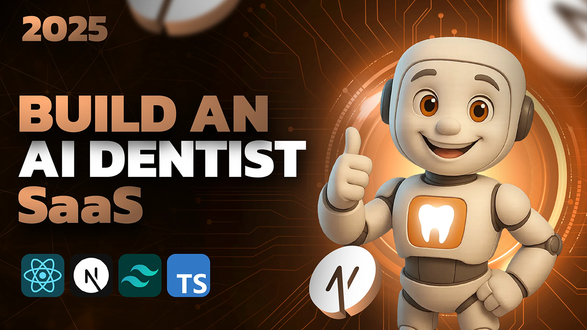

<h1 align="center">🦷 DentWise – AI-Powered Dental Appointment Platform</h1>

<p align="center">
A modern dental appointment management platform featuring AI voice assistance, online appointment booking, secure authentication, subscription management, and an admin dashboard.
</p>



---

## ✨ Features

- 🦷 AI-powered Voice Agent using Vapi
- 📅 Online Appointment Booking
- 👨‍⚕️ Dentist & Service Selection
- 🔐 Secure Authentication with Clerk
- 📧 Email Verification (OTP)
- 📩 Booking Confirmation Emails using Resend
- 📊 Admin Dashboard
- 💳 Subscription Plans & Billing
- 🧾 Automatic Invoice Generation
- 📂 PostgreSQL Database
- ⚡ Fast Data Fetching with TanStack Query
- 🎨 Modern Responsive UI using Tailwind CSS & shadcn/ui

---

## 🛠 Tech Stack

- Next.js 15
- TypeScript
- PostgreSQL
- Prisma ORM
- Clerk Authentication
- Vapi AI
- Resend
- Tailwind CSS
- shadcn/ui
- TanStack Query

---

## 📂 Environment Variables

Create a `.env.local` file and add:

```env
NEXT_PUBLIC_CLERK_PUBLISHABLE_KEY=
CLERK_SECRET_KEY=

DATABASE_URL=

NEXT_PUBLIC_VAPI_ASSISTANT_ID=
NEXT_PUBLIC_VAPI_API_KEY=

ADMIN_EMAIL=

RESEND_API_KEY=

NEXT_PUBLIC_APP_URL=
```

---

## 🚀 Installation

Clone the repository

```bash
git clone https://github.com/Yash-Grade/Dentwise.git
```

Install dependencies

```bash
npm install
```

Run the development server

```bash
npm run dev
```

Visit

```
http://localhost:3000
```

---

## 📸 Preview


---

## 📄 License

MIT License